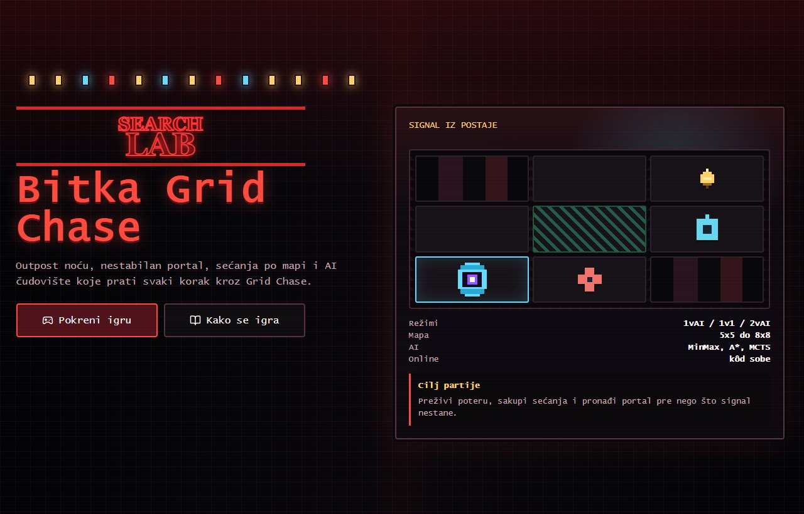

# Bitka Grid Chase

**Turn-based pursuit game · University Artificial Intelligence course**

The React client renders a grid, turns, events and search diagnostics. The Django backend owns game state and legal moves. Django Channels broadcasts changes over WebSockets, with REST endpoints used for game actions and state.

## Preview

[Original Render demo ↗](https://bitka-upside-down.onrender.com/) · The hosted course build uses the original theme. Render Free services may take about a minute to wake up after inactivity. The screenshot and local setup show the public source release.

## Implemented search

| Search | Role in the AI implementation |
| --- | --- |
| Minimax | Scores alternating moves under a search deadline. |
| Alpha–beta | Uses the minimax evaluator with pruning enabled. |
| A* | Searches grid positions and reconstructs a path. |
| Monte Carlo tree search | Selects moves from sampled rollouts. |

See `backend/ai/algorithms.py` for dispatch, heuristics, path reconstruction and rollouts, and `backend/game/engine.py` for game rules. This public source release replaces franchise names and character sprites with original geometric markers.

## Run locally

Use Python 3.12 and Node.js 22 or later. In `backend`, create a virtual environment, install `requirements.txt`, and set `DJANGO_SECRET_KEY` to a locally generated random value. Run `python manage.py migrate` and `python manage.py runserver 127.0.0.1:8000`. SQLite is created locally. In `frontend`, run `npm ci` and `npm run dev`.

`python manage.py test` runs the existing Django engine suite. `npm run build` builds the frontend. The included in-memory channel layer is intended for a single local process.
